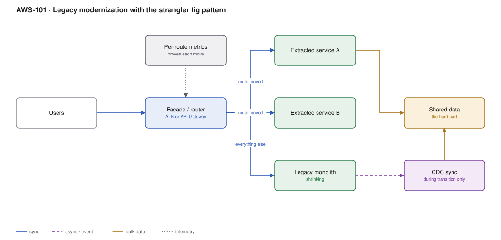

# AWS-101 · Legacy modernization with the strangler fig pattern

> **Category:** [12 · Migration, Hybrid & Edge](readme.md#12) · **Maturity:** Production · **Effort:** L

## The problem

A monolith nobody fully understands runs the business. The proposal is a two-year rewrite
with a big-bang cutover. That proposal has a well-documented failure rate, because during
those two years the old system keeps changing, the new one never catches up, and the
cutover carries all the accumulated risk at once.

The strangler fig inverts it: put a facade in front, move **one route at a time** behind
it, and let the monolith shrink until there is nothing left. Each step is small, independently
valuable, and reversible.

**Use it when** you must modernise a system that cannot be switched off.

**Don't** use it when the system is small enough to rewrite in a quarter, or when the
business is genuinely retiring the capability — just rewrite, or just retire it.

## Why this works and a rewrite does not

| | Big-bang rewrite | Strangler fig |
|---|---|---|
| Value delivered | At the end, if ever | **Continuously** |
| Risk | Concentrated at cutover | Spread across many small steps |
| Rollback | Revert two years of work | Route one endpoint back |
| Feature freeze needed | Usually | **No** |
| Learning | After cutover | Each increment informs the next |

## Components

| Service | Role | The setting that actually matters |
|---|---|---|
| **Facade / router** | The seam | ALB path rules, or API Gateway; this is the whole pattern |
| Extracted services | The new implementation | One bounded capability at a time |
| Legacy monolith | Still serving everything not yet moved | Unchanged for as long as possible |
| **Shared data** | The hard part | Who owns which tables during the transition |
| CDC sync | Keeps old and new consistent | Transitional only — it must have an end date |
| Per-route metrics | Proves each move worked | Error rate and latency per route, old vs new |
| Routing control | Instant rollback | Shift a route back in seconds |

## Flow

1. Put a facade in front of the monolith — an ALB or API Gateway routing **everything** to
   it. Nothing changes functionally; this step alone is the hardest to get approved and the
   most important.
2. Instrument per-route traffic, error rate and latency so you know what you are moving and
   can tell whether it got better.
3. Choose the first capability: high value, low coupling, well-understood. Not the hardest
   one, and not the trivial one.
4. Build it as a new service. Route a small percentage of traffic to it and compare against
   the monolith ([`aws-025`](aws-025-progressive-delivery.md)).
5. Shift to 100% when the metrics agree. Keep the monolith's implementation in place,
   unused, until confidence is established.
6. Handle data: either the new service owns its tables outright, or CDC keeps old and new
   in sync during the transition.
7. Repeat. Delete monolith code as each capability is fully migrated — **deletion is the
   measure of progress**, not deployment count.

## Cost (order of magnitude, relative to a $20,000/month monolith)

| Phase | Monthly |
|---|---|
| Facade added, nothing moved | $20,300 (+ALB) |
| 25% extracted, both running | $24,000 |
| 50% extracted | $26,000 |
| 75% extracted, monolith shrinking | $22,000 |
| Fully extracted, monolith retired | **$14,000** |

**Cost cliff:** **the overlap.** You run both systems for the duration, and the duration is
determined by organisational will rather than by technology. A strangler migration that
stalls at 60% — because the remaining 40% is the hard part and the easy wins are banked —
pays the overlap cost indefinitely. **This is the characteristic failure mode of the
pattern.** Set a completion date and defend it.

**Biggest lever:** finishing. The economics only work if the monolith is eventually
retired.

## Failure modes

| Failure | Symptom | Mitigation |
|---|---|---|
| Migration stalls at 60% | Two systems forever, cost and complexity of both | A completion date with executive sponsorship; track remaining routes publicly |
| Shared mutable database | New and old services fight over the same tables | Clear ownership per table; CDC for a defined transition period only |
| No facade first | Every extraction requires client changes | The facade is step one, always |
| Distributed monolith | Services that cannot deploy independently | Extract by **bounded capability**, not by technical layer |
| Starting with the hardest part | Momentum lost, programme cancelled | Start with something valuable and tractable; build credibility |
| No per-route metrics | Cannot tell whether the new service is better | Instrument before extracting |

## Security notes

- The facade is a natural place to add authentication and authorisation consistently —
  often the first security improvement the legacy system has had in years
  ([`aws-001`](aws-001-lambda-authorizer.md)).
- During transition both systems can write the same data. Ensure authorisation rules match
  exactly, or the new path becomes a bypass of the old path's controls.
- Extracted services should get proper secret management, least-privilege IAM and
  encryption from the start, rather than inheriting the monolith's credentials.
- CDC sync is a privileged data path between two systems. It is transitional — give it an
  end date and remove it, because it is exactly the kind of thing that outlives its purpose.

## What people miss

- **The facade comes first, and it delivers nothing visible.** It is the hardest step to
  get funded and the one that makes everything else possible. Frame it as risk reduction,
  not as refactoring.
- **Data is the hard part, not code.** Extracting a service whose data is entangled with
  everything else is where these programmes actually stall. Plan the data ownership before
  the service boundary.
- **Delete code as you go.** A monolith that still contains the old implementation of every
  migrated capability has not shrunk — it has just stopped being called. Deletion is the
  progress metric.
- **Extract by capability, not by layer.** "Move the data access layer to a service" creates
  a distributed monolith with all the coupling and none of the benefits.
- **Set a completion date.** The pattern's failure mode is not a bad migration; it is an
  unfinished one that becomes permanent.

## See also

- [`aws-096`](aws-096-migration-7rs.md) — "migrate then modernise", and this is the modernise
- [`aws-025`](aws-025-progressive-delivery.md) — shifting traffic route by route
- [`aws-044`](aws-044-cdc-dms.md) — the transitional data sync
- [`aws-019`](aws-019-ecs-fargate-alb.md) — where the extracted services usually land
